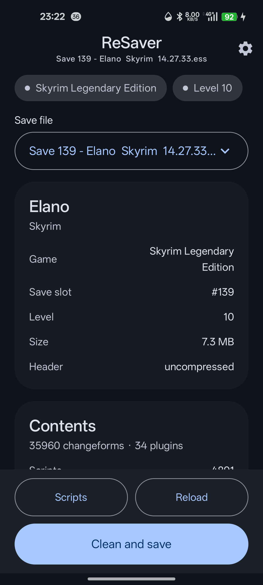

# ReSaver (Android)

An Android port of [ReSaver / FallrimTools](https://www.nexusmods.com/skyrimspecialedition/mods/5031) for cleaning Skyrim Legendary Edition save files on device. Built for static Skyrim LE Android ports, where the usual desktop workflow means copying a save off the phone, cleaning it on a PC and copying it back.

The parser and cleaner are the original Java implementation from ReSaver 6.0.643, vendored and adapted; the interface is a new Jetpack Compose app.



## What it does

- Reads `.ess` saves directly from a folder you pick, including large uncompressed saves.
- Shows what is in each save: player name, level, game version, header compression, changeform count, plugins, scripts, script instances, active threads.
- Scans for the usual ReSaver cleanup targets before writing anything:
  - undefined elements and the threads that reference them
  - unattached script instances
  - non-existent created forms
  - nullrefs in formlists
- Lets you browse every script in the save, filter by name, and mark specific scripts for removal together with all their instances and threads.
- Cleans only the categories you enable, then rewrites the save in place. A timestamped `.ess.bak` copy is created next to the original before every write.
- Refuses to rewrite a save that failed to parse, so a damaged file is never replaced with a truncated one.

## Requirements

- Android 8.0 (API 26) or newer. `java.nio.file` is required by the save parser.
- All files access. Saves live on shared storage, so the app needs to read and write real files rather than a scoped URI.
- A Skyrim LE Android port that keeps its saves on shared storage, for example `Documents/My Games/Skyrim/Saves` inside the port directory.

## Usage

The `iconless` build has no launcher icon. It is started by the Skyrim Mod Loader plugin list (or any other tool that knows its component), which keeps the Android app drawer free of yet another Skyrim entry. The `launcher` build adds a normal drawer icon for direct use.

For other launchers, start it explicitly:

```
am start -n com.skyrimandroid.resaver/.MainActivity
# or
am start -a com.skyrimandroid.resaver.action.OPEN -p com.skyrimandroid.resaver
```

In the app:

1. Open the gear button, pick your saves folder with the system folder picker, or paste the path manually.
2. Select a save from the dropdown. The summary, contents and cleanup counts are read from the file.
3. Tick the cleanup categories you want. Open **Scripts** if you need to remove a specific mod's scripts.
4. **Clean and save** rewrites the save and reports the counts that changed, plus the backup filename.

Cleaning is destructive to stale data by design. Keep a copy of any save you care about, and check the log line for the backup file if you need to roll back.

## Building

Requires JDK 17 and an Android SDK with build-tools 35.

```bash
./gradlew :app:assembleRelease   # both flavors
```

Two flavors exist, same applicationId, versionCode and signing key, so either installs over the other:

| Flavor | APK | Drawer entry |
| --- | --- | --- |
| `iconless` | `app-iconless-release.apk` | no, started by Skyrim Mod Loader |
| `launcher` | `app-launcher-release.apk` | yes |

Build them individually with `:app:assembleIconlessRelease` or `:app:assembleLauncherRelease`.

Release signing reads `keystore.properties` from the project root:

```properties
storeFile=/absolute/path/to/your.jks
storePassword=...
keyAlias=...
keyPassword=...
```

Without that file the release build is unsigned.

The Compose components come from the vendored `skyrim-suite-ui` sources in `suite-ui/`, so the app matches the other Skyrim Android tool ports.

## Layout

- `app/src/main/java/resaver/` – vendored ReSaver core (save parser/writer, Papyrus model, PEX/ESP readers), patched for Android.
- `app/src/main/java/com/skyrimandroid/resaver/` – Kotlin facade (`SaveEngine`) and the Compose UI.
- `app/src/main/java/mf/` – small helpers that came with the vendored core.
- `app/libs/` – upstream runtime dependencies (LZ4, j2html, juniversalchardet).

## Integration

- Package: `com.skyrimandroid.resaver`
- Activity: `com.skyrimandroid.resaver.MainActivity` (exported)
- Custom action: `com.skyrimandroid.resaver.action.OPEN`
- The `iconless` flavor has no drawer entry; the `launcher` flavor adds one. Both keep the activity exported for Skyrim Mod Loader.

## Credits

ReSaver for Android is a port of ReSaver by Mark Fairchild (FallrimTools), used under the Apache License 2.0. See [THIRD_PARTY_NOTICES.md](THIRD_PARTY_NOTICES.md) for the full list.

This is an unofficial fan tool. Skyrim and its assets belong to Bethesda Softworks.